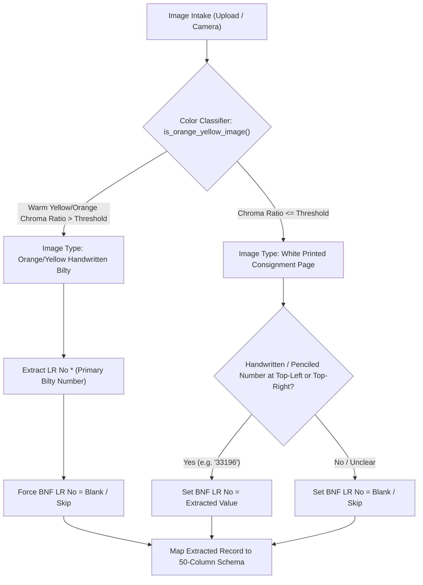

# OCR to Excel: Project Context & Complete System Guide

---

## 1. Project Overview & Philosophy

**OCR to Excel** is a high-accuracy, intelligent dual-component logistics extraction and audit system built for **Box N Freight (BNF)**. It processes physical, printed, and handwritten consignment notes (bilty documents), extracts all logistics data into a standardized **50-column Microsoft Excel format (`.xlsx`)**, maintains an immutable audit lifecycle trail with visual snapshots, and supports soft deletion with a dedicated recycle bin.

### Dedicated Component Documentation
* **Web Component Guide**: [`web_context.md`](file:///D:/AndroidDev/Projects/ocr_to_excel/web_context.md) — Comprehensive guide to the browser-based single-page portal, SheetJS integration, and web APIs.
* **Android Mobile App Guide**: [`android_context.md`](file:///D:/AndroidDev/Projects/ocr_to_excel/android_context.md) — Comprehensive guide to the native Flutter app, dual-engine ML Kit fallback, and Android release builds.

### Core Philosophy
* **Dual-Component 100% Parity**: A web-based single-page portal ([`static/index.html`](file:///D:/AndroidDev/Projects/ocr_to_excel/static/index.html)) and a cross-platform Android mobile app ([`lib/`](file:///D:/AndroidDev/Projects/ocr_to_excel/lib/)) share identical user flows, validations, 9-screen user journey, actions, button placements, and Excel outputs.
* **Intelligent Rule-Based BNF Extraction**: Automated color classification of consignment images:
  * **Orange/Yellow handwritten bilties**: Extract only the `LR No`; do *not* populate `BNF LR No`.
  * **White printed pages**: Extract handwritten/pencil numbers near top-left or top-right as `BNF LR No` (e.g., "33196"); if absent, strictly leave blank.
* **Hybrid Server + On-Device ML OCR Fallback**: Primary extraction via Google Gemini 3.5 Flash Lite on FastAPI backend (`POST /extract-handwriting` / `POST /api/extract-handwriting`). If the server is unreachable, seamless automatic fallback to client-side ML OCR (Google ML Kit on Android, Tesseract.js on Web) with user notification.
* **Complete Audit Trail & Visual Snapshot Certificate**: Every create, edit, and delete action records user name, mobile number, ISO timestamp, version number, and exact field-level diffs. The final generated Excel file contains:
  * **Sheet 1**: `gr_bnf_49` — 50-column standardized logistics import format.
  * **Sheet 2**: `Audit & Lifecycle` — Immutable audit log for regulatory compliance, verification, and file download history.
* **30-Day Auto-Purge & User Data Isolation**: Exported Excel files and related history records are automatically deleted 30 days after export. Each authenticated user only views and downloads their own export history.

---

## 2. System Architecture

```text
                     [ Camera / Phone Gallery / Web Drag & Drop ]
                                        │
                                        ▼
                  ┌──────────────────────────────────────────┐
                  │          Authentication Gate             │
                  │   10-digit Mobile + Name + 6-digit OTP   │
                  │        (Session Token Issued)            │
                  └─────────────────────┬────────────────────┘
                                        │
                                        ▼
                  ┌──────────────────────────────────────────┐
                  │       Image Color Classifier             │
                  │   RGB/HSV Chroma & Warm Hue Ratio Test   │
                  │   (is_orange_yellow_image / isOrangeYellow)│
                  └─────────────────────┬────────────────────┘
                                        │
                                        ▼
                        Primary Extraction (FastAPI Backend)
                         POST /api/extract-handwriting (Gemini)
                                        │
                         ┌──────────────┴──────────────┐
                         ▼                             ▼
                  [ Server Online ]             [ Server Offline ]
                         │                             │
                         ▼                             ▼
                 Gemini 3.5 Flash           Automatic ML OCR Fallback
                 High-accuracy JSON        (Google ML Kit / Tesseract)
                         │                             │
                         └──────────────┬──────────────┘
                                        │
                                        ▼
                  ┌──────────────────────────────────────────┐
                  │         50-Column BNF Schema Mapping     │
                  │   Col 6: "LR No *" | Col 7: "BNF LR No"   │
                  └─────────────────────┬────────────────────┘
                                        │
                                        ▼
                  ┌──────────────────────────────────────────┐
                  │     File Lifecycle & Audit Service       │
                  │   Version increments (v1, v2...), diffs, │
                  │   timestamps, and soft-delete/restore    │
                  └─────────────────────┬────────────────────┘
                                        │
                                        ▼
                  ┌──────────────────────────────────────────┐
                  │             Excel Service                │
                  │  Sheet 1: 50-Column BNF Logistics Data   │
                  │  Sheet 2: Audit & Export History Trail   │
                  │  Visual Certificate & SHA256 Audit Hash  │
                  └──────────────────────────────────────────┘
```

---

## 3. End-to-End 9-Screen User Journey

Both the Web portal and Android application follow the exact 9-screen flow, interconnected via a persistent **Global Step Indicator Flow Bar** (`StepIndicatorBar`) at the bottom of every screen:

| # | Screen Name | Key UI Elements & Functional Behavior | Primary Navigation Target |
|:---:|---|---|---|
| **1** | **Login & OTP** | Mobile number (10 digits), User Name, "+91" prefix, "Send OTP" button (`/api/auth/send-otp`), 6 individual digit input boxes with auto-focus and backspace shift, 30s countdown resend timer, dev_otp auto-fill, Server IP settings modal. | Advances to **Screen 2** upon successful OTP verification. |
| **2** | **Upload LR** | BNF logo header, active user profile badge (Name, +91 Mobile, Logout), "N in Batch" queue badge button, drag & drop zone / camera & gallery buttons, requirements checklist info card. | Opens **Screen 3** (Intake) $\rightarrow$ **Screen 4** (Single file) or **Screen 7** (Multi-file). |
| **3** | **OCR Processing** | Animated document scanner graphic, "Reading Consignment X of Y", 5-step animated checklist (`Image Uploaded` $\rightarrow$ `Reading LR` $\rightarrow$ `Extracting Details` $\rightarrow$ `Mapping 50 Cols` $\rightarrow$ `Validating Data & Preserving Blanks`). Server failure shows non-blocking fallback warning modal. | Auto-transitions to **Screen 4** or **Screen 7** when complete. |
| **4** | **Edit View** | Consignment title header, metadata banner (vN, Created At, Edited At), ML Fallback warning banner, 3-tab layout (`Basic & Logistics`, `Goods & Packaging`, `Financial & Tax`), live image viewer trigger, history/audit log trigger. "Save & Verify" records field diffs and increments version. | Transitions to **Screen 5 (Verified)**. |
| **5** | **Verified** | Large green confirmation checkmark circle, "Consignment Note Verified!", 8-field summary card (LR No, Vehicle, Customer, Route, Packages, Weight, Declared Value, Created At, Last Edited), and **4 Action Buttons**: `View Billing Image`, `Edit Again`, `Preview Excel`, `Batch Queue`. | User selects next action (Screen 6, 4, 8, or 7). |
| **6** | **Multi-Image Document Viewer** | Top toolbar: Close, zoom in/out, 90° rotation, reset view, toggle metadata overlay. Center viewport: interactive pan/pinch image OR **50-column spreadsheet overlay table** (displaying Column #, Name, Extracted Value, Captured/Blank status badges). Bottom thumbnail gallery strip of all uploaded bilties. Bottom actions: `Edit Bilty`, `Excel Format Toggle`, `Preview Excel`, `Batch Queue`. | User navigates between bilty images or switches screens. |
| **7** | **Batch Queue (Add More LR)** | Search filter input, "N in Batch" badge, "Deleted Items (M)" badge, Clear Batch button, Add Consignment button. Row items show: thumbnail, LR No, Vehicle, Customer, Route, Version badge, OCR engine badge, actions (`View Image`, `History vN`, `Edit`, `Delete`). Bottom sticky bar: `Clear`, `Preview Excel`, `Generate Excel`. | Opens **Screen 8 (Excel Preview)** or **Screen 9**. |
| **8** | **Excel Preview** | **Sheet 1: BNF Import Format (50 Columns)**: Clean header toolbar with 50-column badge, horizontally and vertically scrollable 50-column DataTable.<br>**Sheet 2: Audit Snapshot & Lifecycle Log**: Generated Excel Exports History table, 30-day retention countdown, individual export downloads, and **Download All My Exported LRs (.xlsx)**.<br>**Bottom Action Bar**: Prominent **“Add More LR”** (bottom-left) and **“Generate Excel (<N> LRs)”** (bottom-right) synchronized across both sheets. | Generates workbook and opens **Screen 9**. |
| **9** | **Excel Generated** | Success badge, Audit Certificate & Metadata Card (SHA256 audit hash, User, Mobile, Timestamp, Records count, Filename), Visual Snapshot Image card, 30-day retention badge, Action buttons: `Download Excel`, `Share File`, `Preview Excel`, `Start New Batch`. | Downloads file to device and allows starting a fresh batch. |
| **Modal** | **Lifecycle & Recycle Bin** | Accessible from Batch Queue and Edit screens. Dual tabs: **Version History & Audit Log** (displays full history with timestamps, user details, and old $\rightarrow$ new field diffs) and **Deleted Items / Recycle Bin** (displays deleted bilties with one-click **Restore** button). | Restores items back into the active batch. |

---

## 4. Standard 50-Column BNF Logistics Schema Specification

The standardized Microsoft Excel workbook strictly defines **50 columns** in the following sequence:

| Index | Column Header | Data Source / OCR Mapping | Validation & Notes |
|:---:|:---|:---|:---|
| 0 | `stockdt ` | Consignment creation date | Format: `DD/MM/YYYY` |
| 1 | `branchrefcode` | Origin station code | e.g. `BOM`, `DEL`, `BLR` |
| 2 | `grno (*)` | General Consignment / LR Number | Mandatory primary identifier |
| 3 | `grdt *` | Booking / Bilty Date | Mandatory |
| 4 | `deliveryat` | Delivery Station / Hub | Destination branch |
| 5 | **`LR No *`** | Consignment Note Number | Printed or handwritten LR number |
| 6 | **`BNF LR No`** | **Penciled / Handwritten Number** | **Only for white printed pages (top-left / top-right); strictly BLANK for orange/yellow bilties** |
| 7 | `orgrefcode` | Origin Branch Reference Code | 3–5 uppercase alphabetic characters |
| 8 | `destrefcode` | Destination Branch Reference Code | 3–5 uppercase alphabetic characters |
| 9 | `cngr *` | Consignor (Sender) Name | Mandatory |
| 10 | `cngrgstno *` | Consignor GSTIN | 15-character alphanumeric GST format |
| 11 | `cngraddress` | Consignor Street Address & City | Full sender address |
| 12 | `cnge *` | Consignee (Receiver) Name | Mandatory |
| 13 | `cngegstno *` | Consignee GSTIN | 15-character alphanumeric GST format |
| 14 | `cngeaddress` | Consignee Street Address & City | Full receiver address |
| 15 | `billingparty` | Billing Party Name | Default: Consignor or Customer |
| 16 | `billingpartyaddress` | Billing Party Address | Full address |
| 17 | `billingpartygstno` | Billing Party GSTIN | 15-character GSTIN |
| 18 | `bookedpckgs` | Number of Packages Booked | Integer package count |
| 19 | `packing` | Packaging Material / Type | e.g., `BOXES`, `BAGS`, `WOODEN CRATES` |
| 20 | `goods` | Goods / Commodity Description | Nature of goods (e.g., `AUTO PARTS`, `GARMENTS`) |
| 21 | `pmark` | Private Marks / Packaging Stencils | Stencil mark on cartons |
| 22 | `bookedaweight` | Actual Weight (Booked) in KG | Numeric weight |
| 23 | `bookedcweight` | Charged Weight in KG | Numeric weight |
| 24 | `transmode` | Transport Mode | e.g., `ROAD`, `SURFACE`, `EXPRESS` |
| 25 | `freight  *` | Basic Freight Amount | Numeric currency |
| 26 | `stcharges` | Station Charges | Numeric currency |
| 27 | `fuelcharges` | Fuel Surcharge | Numeric currency |
| 28 | `oamount` | Other Charges / Handling Charges | Numeric currency |
| 29 | `hamali` | Loading / Hamali Charges | Numeric currency |
| 30 | `handlingcharges` | Handling Charges | Numeric currency |
| 31 | `doorcharges` | Door Delivery Charges | Numeric currency |
| 32 | `cod` | Cash on Delivery / DOD Amount | Numeric currency |
| 33 | `demurragecharges` | Demurrage / Storage Charges | Numeric currency |
| 34 | `insurancecharges` | Transit Insurance Charges | Numeric currency |
| 35 | `subtotal` | Subtotal Amount | Sum of freight and base surcharges |
| 36 | `sgst` | State GST Amount | Numeric currency |
| 37 | `cgst` | Central GST Amount | Numeric currency |
| 38 | `igst` | Integrated GST Amount | Numeric currency |
| 39 | `total` | Total Freight and Charges | Calculated net billing total |
| 40 | `invoiceno` | Commercial Invoice Number | Shipper invoice reference |
| 41 | `invoiedt` | Commercial Invoice Date | Date on shipper invoice |
| 42 | `ewaybillno` | GST E-Way Bill Number | 12-digit E-Way bill number |
| 43 | `Valid Upto` | E-Way Bill Expiry Date | Validity date/time |
| 44 | `grtype(Don’t know)` | GR / Consignment Category | Standard / Special |
| 45 | `Vehicle No *` | Transport Vehicle Registration No | Indian vehicle plate format (e.g., `MH 04 AB 1234`) |
| 46 | `Vehicle Type *` | Vehicle Body Type | e.g., `32FT MXL`, `14FT`, `CANTER`, `CONTAINER` |
| 47 | `Driver Name *` | Vehicle Driver Name | As declared on bilty |
| 48 | `Mobile no   *` | Driver / Operator Contact Number | 10-digit mobile number |
| 49 | `Liscense No *` | Driver Commercial Driving License | Alphanumeric license number |
| 50 | `valgoods` | Declared Value of Goods (INR) | Value in Indian Rupees |
| 51 | `viaborder` | Transit Border Checkpoint | Border crossing name if applicable |

---

## 5. BNF LR No Extraction & Image Classification Rules



### Classification Implementation
* **Python Backend** ([`main.py`](file:///D:/AndroidDev/Projects/ocr_to_excel/main.py)): Function `is_orange_yellow_image(img)` converts image to HSV, computes the proportion of pixels within yellow-orange hue range (`15°–45°`) with saturation $> 0.25$ and value $> 0.35$.
* **Web Frontend** ([`static/index.html`](file:///D:/AndroidDev/Projects/ocr_to_excel/static/index.html)): Function `isOrangeYellowImageWeb(file)` draws the image on an offscreen HTML5 canvas and evaluates red-to-blue channel dominance.
* **Android Service** ([`lib/services/image_preprocessor.dart`](file:///D:/AndroidDev/Projects/ocr_to_excel/lib/services/image_preprocessor.dart)): Method `isOrangeYellowImage(bytes)` processes pixels in an isolate and detects warm hue density.

---

## 6. Key Project Files & Directories

### Flutter Android Application (`lib/`)
* [`lib/main.dart`](file:///D:/AndroidDev/Projects/ocr_to_excel/lib/main.dart): Application entry point, theme configuration, initialization of SharedPreferences and batch controller.
* [`lib/config/document_schema.dart`](file:///D:/AndroidDev/Projects/ocr_to_excel/lib/config/document_schema.dart): Definition of `grBnf` 50-column schema with labels, validation types, and mandatory flags.
* [`lib/models/batch_item.dart`](file:///D:/AndroidDev/Projects/ocr_to_excel/lib/models/batch_item.dart): Model for consignment notes holding image paths, OCR records, timestamps, version numbers, and audit edit histories.
* [`lib/state/batch_controller.dart`](file:///D:/AndroidDev/Projects/ocr_to_excel/lib/state/batch_controller.dart): Central state management handling camera/gallery intake, OCR pipeline triggers, active user sessions, and soft-delete/restore operations.
* [`lib/services/gemini_backend_service.dart`](file:///D:/AndroidDev/Projects/ocr_to_excel/lib/services/gemini_backend_service.dart): HTTP client connecting to FastAPI backend (`/extract-handwriting`, `/api/auth/*`, `/api/export-excel-meta`, `/api/audit/*`).
* [`lib/services/excel_service.dart`](file:///D:/AndroidDev/Projects/ocr_to_excel/lib/services/excel_service.dart): On-device Excel generator producing workbooks with auto-column sizing and public Downloads folder integration.
* [`lib/services/file_lifecycle_service.dart`](file:///D:/AndroidDev/Projects/ocr_to_excel/lib/services/file_lifecycle_service.dart): Local disk persistence for audit diffs, version increments, and 30-day auto-purge policy.
* [`lib/services/image_preprocessor.dart`](file:///D:/AndroidDev/Projects/ocr_to_excel/lib/services/image_preprocessor.dart): Isolate-based image enhancement and yellow/orange color classifier.
* [`lib/views/login_screen.dart`](file:///D:/AndroidDev/Projects/ocr_to_excel/lib/views/login_screen.dart): **Screen 1** — Mobile + OTP verification, countdown timer, dev auto-fill, and server IP settings modal.
* [`lib/views/home_screen.dart`](file:///D:/AndroidDev/Projects/ocr_to_excel/lib/views/home_screen.dart): **Screen 2** — Upload LR intake, camera/gallery picker, user profile, server status toggle.
* [`lib/views/widgets/ocr_processing_dialog.dart`](file:///D:/AndroidDev/Projects/ocr_to_excel/lib/views/widgets/ocr_processing_dialog.dart): **Screen 3** — 5-step animated extraction checklist.
* [`lib/views/screens/edit_bilty_screen.dart`](file:///D:/AndroidDev/Projects/ocr_to_excel/lib/views/screens/edit_bilty_screen.dart): **Screen 4** — 3-tab consignment editor with diff recording and thumbnail preview.
* [`lib/views/screens/verified_screen.dart`](file:///D:/AndroidDev/Projects/ocr_to_excel/lib/views/screens/verified_screen.dart): **Screen 5** — Confirmation screen with 8-field summary card and 4 action buttons.
* [`lib/views/widgets/billing_image_viewer.dart`](file:///D:/AndroidDev/Projects/ocr_to_excel/lib/views/widgets/billing_image_viewer.dart): **Screen 6** — Multi-image viewer with pinch-zoom, 90° rotation, 50-col spreadsheet toggle, and thumbnail carousel.
* [`lib/views/screens/batch_queue_screen.dart`](file:///D:/AndroidDev/Projects/ocr_to_excel/lib/views/screens/batch_queue_screen.dart): **Screen 7** — Batch queue list with live search, version badges, delete action, and Excel export buttons.
* [`lib/views/screens/excel_preview_screen.dart`](file:///D:/AndroidDev/Projects/ocr_to_excel/lib/views/screens/excel_preview_screen.dart): **Screen 8** — Dual-sheet preview (Sheet 1: 50-col BNF; Sheet 2: Export history & downloads) with bottom action bar ("Add More LR" left, "Generate Excel" right).
* [`lib/views/screens/excel_generated_screen.dart`](file:///D:/AndroidDev/Projects/ocr_to_excel/lib/views/screens/excel_generated_screen.dart): **Screen 9** — Audit certificate, SHA256 hash, visual snapshot toggle, plain-header table, and download/share actions.
* [`lib/views/screens/file_history_screen.dart`](file:///D:/AndroidDev/Projects/ocr_to_excel/lib/views/screens/file_history_screen.dart): **Modal** — Dual tabs for Version History (diffs) and Recycle Bin (restore).
* [`lib/views/widgets/step_indicator_bar.dart`](file:///D:/AndroidDev/Projects/ocr_to_excel/lib/views/widgets/step_indicator_bar.dart): Persistent sticky bottom step flow bar (1–9) with active/completed styling and click navigation.

### Web Component & FastAPI Backend
* [`main.py`](file:///D:/AndroidDev/Projects/ocr_to_excel/main.py): FastAPI backend providing Gemini 3.5 Flash Lite handwriting extraction, OTP verification, server-side Excel snapshot generation, export history endpoints, 30-day retention purge, and static file serving.
* [`static/index.html`](file:///D:/AndroidDev/Projects/ocr_to_excel/static/index.html): Complete standalone web portal matching all 9 screens with SheetJS, Tesseract.js client fallback, Lucide icons, and Tailwind styling.

---

## 7. FastAPI Backend Endpoints Reference (`main.py`)

| Endpoint | Method | Payload / Params | Response | Description |
|---|:---:|---|---|---|
| `/health` | `GET` | None | `{"status": "ok", "service": "ocr_to_excel"}` | Healthcheck endpoint used by apps to verify connectivity. |
| `/api/auth/send-otp` | `POST` | `{"mobile": "...", "name": "..."}` | `{"success": true, "resend_cooldown": 30, "dev_otp": "..."}` | Generates 6-digit OTP code and sets 30-second resend cooldown. |
| `/api/auth/verify-otp` | `POST` | `{"mobile": "...", "otp": "...", "name": "..."}` | `{"success": true, "token": "...", "user": {...}}` | Validates submitted OTP and issues authenticated session token. |
| `/extract-handwriting` | `POST` | `multipart/form-data` (`file`) | `{"status": "completed", "data": {...}, "created_at": "..."}` | Uploads consignment image, classifies color, runs Gemini Flash Lite, and maps 50 BNF fields. |
| `/api/export-excel-meta` | `POST` | JSON document batch + audit logs | `{"success": true, "filename": "...", "download_url": "...", "snapshot_base64": "..."}` | Compiles Sheet 1 (50 cols) + Sheet 2 (Audit Log), creates visual PNG snapshot, logs history, and generates download link. |
| `/download-excel/{filename}` | `GET` | Path variable `filename` | Binary `.xlsx` stream | Streams generated Excel file to browser or mobile download directory. |
| `/api/audit/export-history` | `GET` | `?mobile=...&session_token=...` | `{"success": true, "exports": [...]}` | Retrieves authenticated user's historical Excel exports (30-day retention). |
| `/api/audit/download-all-lrs` | `GET` | `?mobile=...&session_token=...` | Binary `.xlsx` stream | Combines all historical LR records for the user into a single consolidated workbook. |
| `/api/audit/purge-30d` | `POST` | None | `{"success": true, "purged_count": N}` | Automated cleanup purging Excel files and audit logs older than 30 days. |

---

## 8. Android Build & Deployment

### Production Android Release APK
* **File Path**: [`D:\AndroidDev\Projects\ocr_to_excel\build\app\outputs\flutter-apk\app-release.apk`](file:///D:/AndroidDev/Projects/ocr_to_excel/build/app/outputs/flutter-apk/app-release.apk)
* **Build Target**: Release mode with tree-shaken icons and ProGuard optimization.
* **Binary Size**: ~99.1 MB (`103,863,580 bytes`).
* **Android Target Platform**: Android SDK 37 (Android 15+), minimum SDK 29 (Android 10+).

### Build Command
```powershell
Push-Location "D:\AndroidDev\Projects\ocr_to_excel"
flutter build apk --release
Pop-Location
```

---

## 9. Historical Problems Solved Across Iterations

1. **Android Runtime Permissions (Android 13+)**: Resolved startup crashes by separating `READ_MEDIA_IMAGES` and `READ_EXTERNAL_STORAGE` and implementing proactive rationale dialogs in [`PermissionService`](file:///D:/AndroidDev/Projects/ocr_to_excel/lib/services/permission_service.dart).
2. **High-Resolution Camera OOM Crashes**: High-megapixel camera sensors (48MP–108MP) caused memory exhaustion in ML Kit. Solved by processing image scaling and contrast stretching inside an isolate (`compute()`).
3. **Lossy Compression Before OCR**: Fixed `ImagePicker` downsampling from `maxWidth: 1920` and `imageQuality: 80` to lossless full-sensor image intake.
4. **Bilingual Script Support (Latin + Devanagari)**: Added `TextRecognitionScript.devanagiri` in [`OcrService`](file:///D:/AndroidDev/Projects/ocr_to_excel/lib/services/ocr_service.dart) to preserve Hindi and Marathi text in bilingual consignment notes.
5. **Look-Alike Character Confusion**: Eliminated handwritten character swaps (`0` ↔ `O`, `1` ↔ `I`, `5` ↔ `B`) via semantic validator rules in [`Validator`](file:///D:/AndroidDev/Projects/ocr_to_excel/lib/services/validator.dart).
6. **Gemini 3.5 Flash Lite Cloud Integration**: Established direct multipart uploads to FastAPI backend with in-app Server IP configuration dialog.
7. **BNF 50-Column Standardization**: Upgraded initial formats to standard 50-column BNF format with `BNF LR No` at column index 7 immediately following `LR No *`.
8. **BNF LR No Color Discrimination**: Prevented false extraction on yellow handwritten bilties by creating a color classifier that extracts `BNF LR No` only on white printed pages.
9. **Dual-Component Parity**: Achieved complete synchronization between Web ([`static/index.html`](file:///D:/AndroidDev/Projects/ocr_to_excel/static/index.html)) and Android ([`lib/`](file:///D:/AndroidDev/Projects/ocr_to_excel/lib/)) across all 9 screens, dialogs, and actions.
10. **Global Step Flow Navigation**: Implemented [`StepIndicatorBar`](file:///D:/AndroidDev/Projects/ocr_to_excel/lib/views/widgets/step_indicator_bar.dart) across all screens with click navigation and authentication gating.
11. **Multi-Image 50-Column Spreadsheet Overlay**: Added in-viewer spreadsheet toggle in [`BillingImageViewer`](file:///D:/AndroidDev/Projects/ocr_to_excel/lib/views/widgets/billing_image_viewer.dart) displaying all 50 columns with Captured/Blank status pills.
12. **Audit Lifecycle & Soft Delete**: Implemented immutable version tracking with old $\rightarrow$ new diffs and a Recycle Bin with restore capability.
13. **Sheet 2 Export History & 30-Day Auto-Purge**: Stored historical Excel exports in Sheet 2 with individual downloads, "Download All My Exported LRs", and automated 30-day purge retention.
14. **Sheet 1 & Sheet 2 Button Alignment**: Positioned “Add More LR” at the bottom-left and “Generate Excel (<N> LRs)” at the bottom-right across both Sheet 1 and Sheet 2.

---

## 10. Operational Guidelines & Safety Constraints

* **Do NOT run `main.py` directly** from agent tool commands as it starts a blocking FastAPI server process.
* Always preserve existing comments, docstrings, and unrelated methods when making code edits.
* Maintain the exact 50-column order: `LR No *` at index 6 $\rightarrow$ `BNF LR No` at index 7.
* Ensure all tests pass (`flutter test`) before generating new release APK builds.
