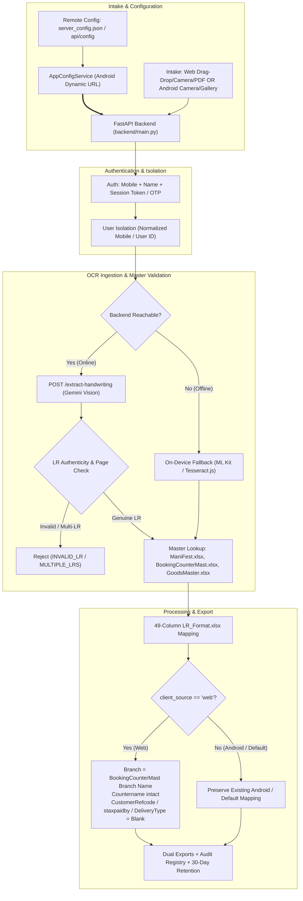

# OCR to Excel: Project Context & Complete System Guide
> **Latest System Update: November 2026** — Reflects the live 49-column `LR_Format.xlsx` schema, Web-only Excel export rules (`Branch` lookup from `BookingCounterMast.xlsx`, blank `CustomerRefcode`/`staxpaidby`/`DeliveryType`), disabled `driver_master.json` auto-fill, master `.xlsx` runtime loaders, file lifecycle registry, centralized remote config, LR authenticity validation, and strict user data isolation.

---

## 1. Project Overview & Philosophy

**OCR to Excel** is a dual-component logistics document extraction and audit platform engineered for **Box N Freight (BNF)**. It automates the ingestion of physical, scanned, photographed, and multi-page PDF consignment notes (bilty documents), extracts logistics data into the standardized **49-column Microsoft Excel format (`LR_Format.xlsx`)**, maintains an audit lifecycle trail, and supports soft deletion with a recycle bin.

### Dedicated Component Documentation
* **Web Component Guide**: [`web_context.md`](web_context.md) — Browser-based single-page studio (`backend/static/index.html`), 49-column preview/export rules, SheetJS/Tesseract.js fallbacks, and web endpoints.
* **Android Mobile App Guide**: [`android_context.md`](android_context.md) — Flutter mobile application (`lib/`), dual-engine ML Kit fallback, and release APK builds.
* **Customer Format Matrix & Prompts**: [`Customer_LR_formats.md`](Customer_LR_formats.md), [`customer_scan_prompt.md`](customer_scan_prompt.md), [`himalaya_context.md`](himalaya_context.md), [`patanjali_context.md`](patanjali_context.md).
* **Original Flutter v1 Roadmap**: [`IMPLEMENTATION_PLAN.md`](IMPLEMENTATION_PLAN.md) — Initial offline ML Kit 4-layer architecture notes.

### Core Architectural Pillars
1. **Dual-Component Architecture**: A single-page **Web Studio** ([`backend/static/index.html`](../backend/static/index.html)) and a **Flutter Android app** ([`lib/`](../lib/)) share the FastAPI backend ([`backend/main.py`](../backend/main.py)) while preserving client-specific export isolation (`client_source="web"` vs. Android `web_mode=False`).
2. **Centralized Remote Server Configuration**: The Flutter client decouples the backend URL via [`AppConfigService`](../lib/services/app_config_service.dart) and [`server_config.json`](../server_config.json) / `GET /api/config`, without requiring manual Server IP UI on Android login.
3. **Genuine LR Validation & Rejection**: Backend validation (`_validate_lr_authenticity`) checks consignment markers, LR numbers, page limits (max 15 pages), and multi-LR packets (`INVALID_LR`, `MULTIPLE_LRS`, `PAGE_LIMIT_EXCEEDED`), discarding invalid documents from history.
4. **Hybrid Server + On-Device OCR Fallback**: Primary extraction uses Google Gemini (`MODEL_NAME` env `GEMINI_MODEL`, defaulting to `gemini-3.5-flash-lite`) on `POST /extract-handwriting`, with automatic client-side fallback (Google ML Kit on Android, Tesseract.js on Web) when the server is unreachable.
5. **Master Data Single Source of Truth (`docs/*.xlsx`)**:
   * [`docs/LR_Format.xlsx`](LR_Format.xlsx) — Canonical 49-column export header schema & downloadable template.
   * [`docs/ManiFest.xlsx`](ManiFest.xlsx) — 45 customer/department rows (16 customer accounts, 3 `INACTIVE`) and GSTIN mappings.
   * [`docs/BookingCounterMast.xlsx`](BookingCounterMast.xlsx) — 30 booking counters (`Counter Name` → `Branch Name`).
   * [`docs/GoodsMaster.xlsx`](GoodsMaster.xlsx) — 2,789 commodity entries (2,776 active `Active == 'Y'`).
   * [`docs/VehicleTypeMaster.xlsx`](VehicleTypeMaster.xlsx) — 154 vehicle type definitions.
6. **Driver Auto-Fill Disabled During OCR/Edit**: Auto-populating driver credentials from `driver_master.json` during extraction or form load is explicitly **disabled** in both [`backend/main.py`](../backend/main.py) and [`backend/static/index.html`](../backend/static/index.html) (`autoFetchAndFillMasterDriverWeb()`). Missing driver fields remain empty (`""`) unless present in the document dossier or entered manually (while `/api/master/driver` and `/api/master/register-driver` endpoints remain available).
7. **Multi-Page & Compliance Document Scraping**: Ingests multi-page PDFs/combined uploads (Bilty + Tax Invoice + E-Way Bill + RC Form 23A + DL + PAN + Seal photo) rendered at high resolution.
8. **Audit Trail & Export Lifecycle**: Tracks versions, user details, ISO timestamps, field-level diffs, and 30-day auto-purge via `file_lifecycle_service.py` and `audit_snapshot.py`. Audit Excel workbooks include `Sheet1` and `History`.
9. **Strict User Data Isolation & Payload Optimization**: Endpoints (`/api/previous-uploads`, `/api/user-cloud-storage`, `/api/export-audit/history`) isolate records by normalized 10-digit mobile number / user ID and strip heavy base64 images from JSON persistence.

---

## 2. End-to-End System Architecture



---

## 3. Standard 49-Column BNF Schema (`LR_Format.xlsx`)

Both the Web Studio (`BNF_49_COLUMNS`) and Backend/Android exporters (`LR_FORMAT_49_HEADERS` / `GR_BNF_49_HEADERS` / `lrFormat49Headers`) use the **49 columns** defined in [`docs/LR_Format.xlsx`](LR_Format.xlsx) (zero asterisks in exported Excel headers; `BNF LR No` has been permanently removed):

| Index | Export Header | Data Source / Mapping Notes |
|:---:|:---|:---|
| 0 | `Branch` | **Web (`client_source="web"`)**: Resolved `Branch Name` from `docs/BookingCounterMast.xlsx` matching `Countername` (blank if no Counter). **Android/Default**: `branchrefcode` / `branch` / `counter_name`. |
| 1 | `GrNo` | Primary Consignment / LR Number (`grno (*)` / `LR No *`). |
| 2 | `GrDate` | Consignment / Bilty booking date (`DD-MM-YYYY` in `.xlsx`). |
| 3 | `GrType` | Payment term (`TBB`, `PAID`, `TO PAY`). |
| 4 | `Customer` | Billed corporate customer name (`Customer Name *`). |
| 5 | `CustomerDepartment` | Exact department string from `docs/ManiFest.xlsx` (`Depatment Name`). |
| 6 | `Countername` | Exact `Counter Name` from Column 1 of `docs/BookingCounterMast.xlsx` (never overwritten by `Branch`). |
| 7 | `TransitDays` | Integer day difference between `GrDate` and E-Way `ValidUpto`, or blank. |
| 8 | `Origen` | Origin station / city (`orgrefcode`). |
| 9 | `Destination` | Destination station / city (`destrefcode`). |
| 10 | `Consignor` | Consignor name & address (`cngr *`). |
| 11 | `ConsignorGST` | Space-free 15-character Consignor GSTIN (`cngrgstno *`). |
| 12 | `Consignee` | Consignee name & address (`cnge *`). |
| 13 | `ConsigneeGST` | Space-free 15-character Consignee GSTIN (`cngegstno *`). |
| 14 | `ProductName` | Product Type (`Surface-FTL`, `Surface-PTL`, `Global-TT`, `Global-MT`, `AIR`; kept separate from `productcode`). |
| 15 | `Packing` | Packaging unit (`Box`, `Cartons`, `Bag`, etc.). |
| 16 | `PMark` | Private mark / seal code (currently cleared blank in Web/Backend `map_to_gr_row`). |
| 17 | `Goods` | Commodity description (matched against active `GoodsMaster.xlsx` entries in backend post-processing). |
| 18 | `VehicleNo` | Vehicle registration number (`Vehicle No *`). |
| 19 | `VehicleTypeName` | Vehicle body/type (`Vehicle Type *`). |
| 20 | `DriverName` | Driver name (only if present in document or entered manually; `driver_master.json` auto-fill disabled). |
| 21 | `DriverMobileNo` | Driver 10-digit phone (blank if absent). |
| 22 | `DrivingLicenseNo` | Commercial driving licence number (blank if absent). |
| 23 | `DrivingValidUpto` | Driving licence transport validity date (`DD-MM-YYYY`, decoupled from E-Way `ValidUpto`). |
| 24 | `LoadingStartDate` | Dispatch / loading date (`DD-MM-YYYY`, defaults to `GrDate`). |
| 25 | `Freight` | Mandatory manual freight charge (validated non-empty before export). |
| 26 | `OtherAmount` | Other charges (`oamount`; defaults to `0.0` / `0.00`, never copied from `valgoods`). |
| 27 | `CGST` | Central GST (`0` / `0.00` for FTL). |
| 28 | `SGST` | State GST (`0` / `0.00` for FTL). |
| 29 | `IGST` | Always output as `0.00`. |
| 30 | `Received` | Received amount (`0` if absent). |
| 31 | `Advance` | Driver advance (`0` if absent). |
| 32 | `CollectionBranch` | Collection station (`collectionstncode`, defaults from origin/destination). |
| 33 | `FTL` | Load type (`FTL`, `LTL`, `Y`, `N`). |
| 34 | `PCS` | Package count (`pckgs`). |
| 35 | `OrderWeight` | Order weight if specified. |
| 36 | `ActualWeight` | Actual weight in KG (`aweight`). |
| 37 | `ChargableWeight` | Charged weight in KG (`cweight`). |
| 38 | `ContractWeight` | Contract weight if specified. |
| 39 | `ExtraMt` | Extra metric tons if specified. |
| 40 | `CustomerRefcode` | **Web (`client_source="web"`)**: Always empty (`None`/blank). **Android/Default**: `custrefcode` (defaults to `CM001`). |
| 41 | `staxpaidby` | **Web (`client_source="web"`)**: Always empty (`None`/blank). **Android/Default**: `C` / `E` / `T`. |
| 42 | `DeliveryType` | **Web (`client_source="web"`)**: Always empty (`None`/blank). **Android/Default**: `D` / `G`. |
| 43 | `EwayBillNo` | 12-digit GST E-Way Bill number. |
| 44 | `ValidUpto` | E-Way Bill validity expiry date (`DD-MM-YYYY`). |
| 45 | `InvoiceNo` | Commercial invoice number. |
| 46 | `InvoieDate` | Commercial invoice date (`DD-MM-YYYY`). |
| 47 | `ValueOfGoods` | Declared goods value (`valgoods`). |
| 48 | `viaborder` | Transit border checkpoint if applicable. |

---

## 4. Master Data Integration (`docs/*.xlsx`)

1. **Customer & Department Manifest ([`docs/ManiFest.xlsx`](ManiFest.xlsx))**:
   * Contains **45** department records across **16** customer names (Himalaya Wellness Company, Patanjali Parivahan / Indore / Bhopal / Jalna, Global Marketing / Global Marketing Reyn, Gold Plus Float Glass, Indra Hosiery Mills, Vesco Cycle, Hi Tech International, Monte Carlo Fashions, UM Orthotics, Shree Ciment; 3 rows carry `Status = INACTIVE`).
   * Used for strict department validation (`validate_department_exact`), Origin-City department auto-detection (`auto_detect_department`), and party GSTIN lookup (`_match_party_gst`).
2. **Booking Counters Master ([`docs/BookingCounterMast.xlsx`](BookingCounterMast.xlsx))**:
   * Contains **30** counter records (`Counter Name` → `Branch Name`, IDs `1..30`, including numeric counter `1` → `NAGPUR_1`).
   * Used for strict counter validation (`validate_counter_exact`), Origin-City counter detection (`auto_detect_counter`), `/api/master/counters`, and Web `Branch` resolution (`get_branch_name_for_counter` / `getBranchNameForCounterWeb`).
3. **Goods Master ([`docs/GoodsMaster.xlsx`](GoodsMaster.xlsx))**:
   * Contains **2,789** rows (**2,776** active `Active == 'Y'`) served by `/api/master/goods-master` & `/api/master/goods` and used to validate/filter `Goods` in backend post-processing.
4. **Vehicle Type Master ([`docs/VehicleTypeMaster.xlsx`](VehicleTypeMaster.xlsx))**:
   * Contains **154** vehicle type rows served by `/api/master/vehicle-types`.
5. **Driver Registry ([`backend/data/driver_master.json`](../backend/data/driver_master.json))**:
   * Exposed via `/api/master/driver` and `/api/master/register-driver`; automatic OCR/form population from this registry is **disabled** so absent driver details remain blank for manual verification.

---

## 5. FastAPI Backend Endpoints Reference ([`backend/main.py`](../backend/main.py))

| Endpoint | Method | Purpose |
|---|:---:|---|
| `/` & `/web` | `GET` | Serves [`backend/static/index.html`](../backend/static/index.html). |
| `/api/health` | `GET` | Healthcheck reporting status, model, and endpoints. |
| `/api/config` | `GET` | Serves centralized remote config (`server_config.json`). |
| `/download-apk` | `GET` | Streams Android release APK (`releases/ocr_to_excel.apk`). |
| `/download-template` & `/api/template/download` | `GET` | Streams `docs/LR_Format.xlsx`. |
| `/extract-handwriting` | `POST` | Color classification, Gemini Vision OCR, LR validation, and field mapping. |
| `/api/assemble-pdf` | `POST` | Combines multi-file uploads into a single PDF dossier. |
| `/generate-excel` | `POST` | Streams `.xlsx` workbook (accepts `client_source="web"` for Web export rules). |
| `/api/auth/login`, `/send-otp`, `/verify-otp`, `/me`, `/logout` | `POST`/`GET` | User authentication and token sessions. |
| `/api/master/manifest` & `/parties` | `GET` | Customer/department mappings and GSTINs from `ManiFest.xlsx`. |
| `/api/master/counters` | `GET` | Counter list and `(counter_name, branch_name)` records from `BookingCounterMast.xlsx`. |
| `/api/master/vehicle-types` | `GET` | Vehicle types from `VehicleTypeMaster.xlsx`. |
| `/api/master/goods-master` & `/goods` | `GET` | Active commodity records from `GoodsMaster.xlsx`. |
| `/api/master/driver` & `/register-driver` | `GET`/`POST` | Driver registry lookup and registration endpoints. |
| `/api/export-excel-meta` | `POST` | Generates user `.xlsx` + backend audit `.xlsx` (honors `client_source="web"`). |
| `/api/download-export/{filename}` | `GET` | Downloads user `.xlsx` export. |
| `/api/download-audit-export/{filename}` | `GET` | Downloads backend audit `.xlsx` copy. |
| `/api/export-audit/snapshot/{export_id}` | `GET` | Retrieves export audit snapshot metadata. |
| `/api/export-audit/history` | `GET` | User-isolated export history (30-day retention). |
| `/api/export-audit/{target}` & `/delete` | `DELETE`/`POST` | Deletes an export audit entry and its files. |
| `/api/export-audit/download-all` | `GET` | Consolidated `.xlsx` of user's past exports (supports `client_source=web`). |
| `/api/export-audit/cleanup-expired` | `POST` | Purges expired files and audit records older than 30 days. |
| `/api/previous-uploads`, `/delete`, `/clear-all` | `GET`/`POST` | User-isolated upload history management. |
| `/api/user-cloud-storage/*` | `GET`/`POST` | User-isolated active batch and upload history persistence (`save-batch`, `clear-all`, `delete-lr`, `delete-upload-history`, `undismiss-upload`). |
| `/api/files/*` | `GET`/`POST` | Lifecycle metadata, soft-deleted Recycle Bin, version restore, and preview snapshots. |

---

## 6. Key Project Directories & Files

```text
ocr_to_excel/
├── lib/                                  # Flutter app (37 Dart test files in test/)
│   ├── config/document_schema.dart       # Schema definitions (grStock, grBnf, invoice, receipt, etc.)
│   ├── models/                           # batch_item.dart, extraction_result.dart, ocr_word.dart
│   ├── services/                         # app_config_service, gemini_backend_service, excel_service (lrFormat49Headers), master_data_service, file_lifecycle_service, ocr_service, etc.
│   ├── state/batch_controller.dart
│   └── views/                            # Screens & widgets
├── backend/
│   ├── main.py                           # FastAPI app, OCR pipeline, master loaders & Excel generator
│   ├── auth_service.py                   # OTP & token session store
│   ├── user_cloud_service.py             # Per-user cloud DB (backend/data/cloud_db/)
│   ├── file_lifecycle_service.py         # Version vault & SHA-256 registry
│   ├── audit_snapshot.py                 # Audit log & 30-day purge
│   ├── network_server.py                 # LAN pairing helper
│   ├── static/index.html                 # Web Studio SPA
│   ├── data/                             # driver_master.json, users.json, sessions.json, cloud_db/
│   ├── export/                           # upload_LR/, snapshots_excel/, metadata/
│   └── test_*.py                         # 9 backend Python test scripts
├── docs/                                 # Context guides, prompt specs, 5 master/template .xlsx files, sample dossiers
├── releases/ocr_to_excel.apk             # Android release APK
├── scripts/                              # search_files.py, manage_users.py, sync_exports.ps1
├── main.py, run_server.bat, server_config.json
```

---

## 7. Operational Guidelines & Safety Constraints

1. **Server Process Safety**: Do not run `backend/main.py` directly inside blocking tool calls (starts an indefinite Uvicorn HTTP server). Use `run_server.bat` or `python main.py` in a dedicated terminal.
2. **Preserve `docs/*.xlsx` Runtime Sources**: `LR_Format.xlsx`, `ManiFest.xlsx`, `BookingCounterMast.xlsx`, `GoodsMaster.xlsx`, and `VehicleTypeMaster.xlsx` are read at runtime by `backend/main.py`; keep their paths and column contracts aligned with `MasterDataService` and backend tests.
3. **Web vs. Android Export Isolation**: Web-only rules (`Branch` mapped from `BookingCounterMast.xlsx` via Counter; `CustomerRefcode`, `staxpaidby`, and `DeliveryType` always empty) must stay scoped via `client_source="web"` (`web_mode=True`) so Android (`lib/services/excel_service.dart` and non-web backend callers) remains unbroken.
4. **Preserve `Countername` Integrity**: Always keep `Countername` (`Counter`) as the exact `Counter Name` from Column 1 of `BookingCounterMast.xlsx`; never overwrite it with `Branch Name`.
5. **Strict User Data Isolation**: All history, previous upload, and cloud DB queries must filter strictly by authenticated user mobile / ID.
6. **No Unauthorized Code Changes**: Never modify code or master files outside explicitly approved scope.
