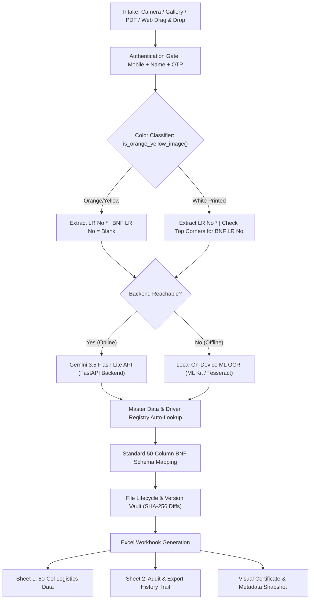

# OCR to Excel: Project Context & Complete System Guide
> **Latest System Update: October 2026** — Comprehensive specification covering Dual-Component Parity, Master Data Integration, Driver Master Registry, Multi-Page Document Scraping, File Lifecycle Registry, and Production Deployment.

---

## 1. Project Overview & Philosophy

**OCR to Excel** is an enterprise-grade, high-accuracy intelligent dual-component logistics extraction and audit platform engineered for **Box N Freight (BNF)**. It automates the ingestion of physical, scanned, photographed, and digital consignment notes (bilty documents), extracts all logistics data into a standardized **50-column Microsoft Excel format (`.xlsx`)**, maintains an immutable audit lifecycle trail with visual snapshots, and supports soft deletion with a dedicated recycle bin.

### Dedicated Component Documentation
* **Web Component Guide**: [`web_context.md`](file:///D:/AndroidDev/Projects/ocr_to_excel/docs/web_context.md) — Browser-based single-page portal, SheetJS integration, and responsive web workflows.
* **Android Mobile App Guide**: [`android_context.md`](file:///D:/AndroidDev/Projects/ocr_to_excel/docs/android_context.md) — Native Flutter mobile application, dual-engine ML Kit fallback, and release builds.
* **Original Implementation Roadmap**: [`IMPLEMENTATION_PLAN.md`](file:///D:/AndroidDev/Projects/ocr_to_excel/docs/IMPLEMENTATION_PLAN.md) — 4-layer architecture, Dart service interfaces, and test plans.

### Core Philosophy & Architectural Pillars
1. **Dual-Component 100% Parity**: A web-based single-page portal ([`backend/static/index.html`](file:///D:/AndroidDev/Projects/ocr_to_excel/backend/static/index.html)) and a cross-platform Android mobile app ([`lib/`](file:///D:/AndroidDev/Projects/ocr_to_excel/lib/)) share identical user flows, validations, 9-screen user journey, actions, button placements, and Excel outputs.
2. **Intelligent Rule-Based BNF Extraction**: Automated color classification of consignment images:
   * **Orange/Yellow handwritten bilties**: Extract only the `LR No *`; do *not* populate `BNF LR No` (strictly preserved as blank).
   * **White printed pages**: Extract handwritten/pencil numbers near top-left or top-right as `BNF LR No` (e.g., "33196"); if absent, strictly leave blank.
3. **Hybrid Server + On-Device ML OCR Fallback**: Primary extraction via Google Gemini 3.5 Flash Lite on FastAPI backend (`POST /extract-handwriting`). If the server is unreachable, seamless automatic fallback to client-side ML OCR (Google ML Kit on Android, Tesseract.js on Web) with user notification.
4. **Master Data & Customer Integration**: Real logistics master datasets imported from [`ManiFest.xlsx`](file:///D:/AndroidDev/Projects/ocr_to_excel/docs/ManiFest.xlsx) (46 customer/department mappings with GSTINs) and [`BookingCounterMast.xlsx`](file:///D:/AndroidDev/Projects/ocr_to_excel/docs/BookingCounterMast.xlsx) (31 booking counters across India).
5. **Driver Master Registry & Auto-Fetch**: Instant vehicle registration plate lookup (`KA23B5235`, `BR29GA2038`, etc.) auto-populating driver name, phone number, driving license, and license validity from [`backend/data/driver_master.json`](file:///D:/AndroidDev/Projects/ocr_to_excel/backend/data/driver_master.json) and client-side [`MasterDataService`](file:///D:/AndroidDev/Projects/ocr_to_excel/lib/services/master_data_service.dart).
6. **Multi-Page & Compliance Document Scraping**: Ingests multi-page PDFs or multi-image packets combining the consignment note with vehicle Registration Certificate (RC Form 23A), Goods Permits, Pollution Under Control (PUC) certificates, and Driving Licences.
7. **Complete Audit Trail & Visual Certificate**: Every create, edit, and delete action records user name, mobile number, ISO timestamp, version number, and exact field-level diffs (`old` $\rightarrow$ `new`). The final generated Excel file contains:
   * **Sheet 1**: `gr_bnf_49` — 50-column standardized logistics import format.
   * **Sheet 2**: `Audit & Lifecycle` — Immutable audit log for regulatory compliance, verification, and file download history.
8. **30-Day Auto-Purge & User Data Isolation**: Exported Excel files and related history records are automatically deleted 30 days after export. Each authenticated user only views and downloads their own export history.

---

## 2. End-to-End System Architecture



---

## 3. End-to-End 9-Screen User Journey

Both the Web portal and Android application follow the exact 9-screen flow, interconnected via a persistent **Global Step Indicator Flow Bar** (`StepIndicatorBar`) at the bottom of every screen:

| # | Screen Name | Key UI Elements & Functional Behavior | Primary Navigation Target |
|:---:|---|---|---|
| **1** | **Login & OTP** | Mobile number (10 digits), User Name, "+91" prefix, "Send OTP" button (`/api/auth/send-otp`), 6 individual digit input boxes with auto-focus and backspace shift, 30s countdown resend timer, dev_otp auto-fill, Server IP settings modal. | Advances to **Screen 2** upon successful OTP verification. |
| **2** | **Upload LR** | BNF logo header, active user profile badge (Name, +91 Mobile, Logout), "N in Batch" queue badge button, drag & drop zone / camera & gallery buttons, requirements checklist info card. | Opens **Screen 3** (Intake) $\rightarrow$ **Screen 4** (Single file) or **Screen 7** (Multi-file). |
| **3** | **OCR Processing** | Animated document scanner graphic, "Reading Consignment X of Y", 5-step animated checklist (`Image Uploaded` $\rightarrow$ `Reading LR` $\rightarrow$ `Extracting Details` $\rightarrow$ `Mapping 50 Cols` $\rightarrow$ `Validating Data & Preserving Blanks`). Server failure shows non-blocking fallback warning modal. | Auto-transitions to **Screen 4** or **Screen 7** when complete. |
| **4** | **Edit View** | Consignment title header, metadata banner (vN, Created At, Edited At), ML Fallback warning banner, 3-tab layout (`Basic & Logistics`, `Goods & Packaging`, `Financial & Tax`), live image viewer trigger, history/audit log trigger. "Save & Verify" records field diffs and increments version. | Transitions to **Screen 5 (Verified)**. |
| **5** | **Verified** | Large green confirmation checkmark circle, "Consignment Note Verified!", 8-field summary card (LR No, Vehicle, Customer, Route, Packages, Weight, Declared Value, Created At, Last Edited), and **4 Action Buttons**: `View Billing Image`, `Edit Again`, `Preview Excel`, `Batch Queue`. | User selects next action (Screen 6, 4, 8, or 7). |
| **6** | **Multi-Image Document Viewer** | Top toolbar: Close, zoom in/out, 90° rotation, reset view, toggle metadata overlay. Center viewport: interactive pan/pinch image OR **50-column spreadsheet overlay table** (displaying Column #, Name, Extracted Value, Captured/Blank status badges). Bottom thumbnail gallery strip of all uploaded bilties. Bottom actions: `Edit Bilty`, `Excel Format Toggle`, `Preview Excel`, `Batch Queue`. | User navigates between bilty images or switches screens. |
| **7** | **Batch Queue (Add More LR)** | Search filter input, "N in Batch" badge, "Deleted Items (M)" badge, Clear Batch button, Add Consignment button. Row items show: thumbnail, LR No, Vehicle, Customer, Route, Version badge, OCR engine badge, actions (`View Image`, `History vN`, `Edit`, `Delete`). Bottom sticky bar: `Clear`, `Preview Excel`, `Generate Excel`. | Opens **Screen 8 (Excel Preview)** or **Screen 9**. |
| **8** | **Excel Preview** | **Sheet 1: BNF Import Format (50 Columns)**: Clean header toolbar with 50-column badge, horizontally and vertically scrollable 50-column DataTable.<br>**Sheet 2: Audit Snapshot & Lifecycle Log**: Generated Excel Exports History table, 30-day retention countdown, individual export downloads, and **Download All My Exported LRs (.xlsx)**.<br>**Bottom Action Bar**: Prominent **“Add More LR”** (bottom-left) and **“Generate Excel (<N> LRs)”** (bottom-right) synchronized across both sheets. | Generates workbook and opens **Screen 9**. |
| **9** | **Excel Generated** | Success badge, Audit Certificate & Metadata Card (SHA256 audit hash, User, Mobile, Timestamp, Records count, Filename), Visual Snapshot Image card, 30-day retention badge, Action buttons: `Download Excel`, `Share File`, `Preview Excel`, `Start New Batch`. | Downloads file to device and allows starting a fresh batch. |
| **Modal** | **Lifecycle & Recycle Bin** | Accessible from Batch Queue and Edit screens. Dual tabs: **Version History & Audit Log** (displays full history with timestamps, user details, and old $\rightarrow$ new field diffs) and **Deleted Items / Recycle Bin** (displays deleted bilties with one-click **Restore** button). | Restores items back into the active batch. |

---

## 4. Standard 50-Column BNF Logistics Schema Specification

The standardized Microsoft Excel workbook strictly defines **50 columns** derived directly from [`BNF file Modify.xlsx`](file:///D:/AndroidDev/Projects/ocr_to_excel/docs/BNF%20file%20Modify.xlsx):

| Index | Column Header | Data Source / OCR Mapping | Validation & Notes |
|:---:|:---|:---|:---|
| 0 | `stockdt ` | Consignment creation date | Format: `DD/MM/YYYY` |
| 1 | `branchrefcode` | Origin station code | e.g. `BOM`, `DEL`, `BLR` |
| 2 | `grno (*)` | General Consignment / LR Number | Mandatory primary identifier |
| 3 | `grdt *` | Booking / Bilty Date | Mandatory |
| 4 | `deliveryat` | Delivery Station / Hub | Destination branch |
| 5 | **`LR No *`** | Consignment Note Number | Printed or handwritten LR number |
| 6 | **`BNF LR No`** | **Penciled / Handwritten Number** | **Only for white printed pages (top-left / top-right); strictly BLANK for orange/yellow bilties** |
| 7 | `orgrefcode` | Origin Branch Reference Code | 3–5 uppercase alphabetic characters |
| 8 | `destrefcode` | Destination Branch Reference Code | 3–5 uppercase alphabetic characters |
| 9 | `cngr *` | Consignor (Sender) Name | Mandatory |
| 10 | `cngrgstno *` | Consignor GSTIN | 15-character alphanumeric GST format |
| 11 | `cngraddress` | Consignor Street Address & City | Full sender address |
| 12 | `cnge *` | Consignee (Receiver) Name | Mandatory |
| 13 | `cngegstno *` | Consignee GSTIN | 15-character alphanumeric GST format |
| 14 | `cngeaddress` | Consignee Street Address & City | Full receiver address |
| 15 | `billingparty` | Billing Party Name | Default: Consignor or Customer |
| 16 | `billingpartyaddress` | Billing Party Address | Full address |
| 17 | `billingpartygstno` | Billing Party GSTIN | 15-character GSTIN |
| 18 | `bookedpckgs` | Number of Packages Booked | Integer package count |
| 19 | `packing` | Packaging Material / Type | e.g., `BOXES`, `BAGS`, `WOODEN CRATES` |
| 20 | `goods` | Goods / Commodity Description | Nature of goods (e.g., `AUTO PARTS`, `GARMENTS`) |
| 21 | `pmark` | Private Marks / Packaging Stencils | Stencil mark on cartons |
| 22 | `bookedaweight` | Actual Weight (Booked) in KG | Numeric weight |
| 23 | `bookedcweight` | Charged Weight in KG | Numeric weight |
| 24 | `transmode` | Transport Mode | e.g., `ROAD`, `SURFACE`, `EXPRESS` |
| 25 | `freight  *` | Basic Freight Amount | Numeric currency |
| 26 | `stcharges` | Station Charges | Numeric currency |
| 27 | `fuelcharges` | Fuel Surcharge | Numeric currency |
| 28 | `oamount` | Other Charges / Handling Charges | Numeric currency |
| 29 | `hamali` | Loading / Hamali Charges | Numeric currency |
| 30 | `handlingcharges` | Handling Charges | Numeric currency |
| 31 | `doorcharges` | Door Delivery Charges | Numeric currency |
| 32 | `cod` | Cash on Delivery / DOD Amount | Numeric currency |
| 33 | `demurragecharges` | Demurrage / Storage Charges | Numeric currency |
| 34 | `insurancecharges` | Transit Insurance Charges | Numeric currency |
| 35 | `subtotal` | Subtotal Amount | Sum of freight and base surcharges |
| 36 | `sgst` | State GST Amount | Numeric currency |
| 37 | `cgst` | Central GST Amount | Numeric currency |
| 38 | `igst` | Integrated GST Amount | Numeric currency |
| 39 | `total` | Total Freight and Charges | Calculated net billing total |
| 40 | `invoiceno` | Commercial Invoice Number | Shipper invoice reference |
| 41 | `invoiedt` | Commercial Invoice Date | Date on shipper invoice |
| 42 | `ewaybillno` | GST E-Way Bill Number | 12-digit E-Way bill number |
| 43 | `Valid Upto` | E-Way Bill Expiry Date | Validity date/time |
| 44 | `grtype(Don’t know)` | GR / Consignment Category | Standard / Special |
| 45 | `Vehicle No *` | Transport Vehicle Registration No | Indian vehicle plate format (e.g., `MH 04 AB 1234`) |
| 46 | `Vehicle Type *` | Vehicle Body Type | e.g., `32FT MXL`, `14FT`, `CANTER`, `CONTAINER` |
| 47 | `Driver Name *` | Vehicle Driver Name | As declared on bilty or Driver Registry |
| 48 | `Mobile no   *` | Driver / Operator Contact Number | 10-digit mobile number |
| 49 | `Liscense No *` | Driver Commercial Driving License | Alphanumeric license number |
| 50 | `valgoods` | Declared Value of Goods (INR) | Value in Indian Rupees |
| 51 | `viaborder` | Transit Border Checkpoint | Border crossing name if applicable |

---

## 5. Master Data Integration & Driver Registry

### A. Customer & Department Manifest (`ManiFest.xlsx`)
The system integrates 46 real logistics accounts from [`docs/ManiFest.xlsx`](file:///D:/AndroidDev/Projects/ocr_to_excel/docs/ManiFest.xlsx):
* **Himalaya Wellness Company**: Departments across Siliguri, Raipur, Bhiwandi, Ranchi, Nagpur, Indore, Patna, Chennai, Zirakpur, Jaipur, Ahmedabad, Delhi, Vijayawada, Tumkur, Hyderabad, Kolkata, Bangalore.
* **Patanjali Parivahan Private Limited**: Departments across Hyderabad, Karanpura, Indore, Jalna, Bhopal, Delhi.
* **Other Accounts**: Global Marketing, Indra Hosiery Mills, Vesco Cycle, Monte Carlo Fashions, UM Orthotics, Shree Ciment, etc.
* **GSTIN Validation**: Each department contains pre-verified state GST numbers enabling automatic validation and autofill during OCR post-processing.

### B. Booking Counters Master (`BookingCounterMast.xlsx`)
The system provides auto-completion against 31 official BNF booking hubs from [`docs/BookingCounterMast.xlsx`](file:///D:/AndroidDev/Projects/ocr_to_excel/docs/BookingCounterMast.xlsx):
* Hubs: `DELHI`, `KOL` (Kolkata), `MUMBAI 01`, `BANG-01` (Bangalore), `BEL` (Belgaum), `BHOPAL`, `HYDERABAD`, `LUDHIANA`, `JALNA`, `CHENNAI`, `INDORE-1`, `TUMKUR`, `VIJAYWADA`, `GURUGRAM_HUB`, etc.

### C. Driver Master Registry & Automatic Vehicle Resolution
* **Driver Database**: Stored on backend in [`backend/data/driver_master.json`](file:///D:/AndroidDev/Projects/ocr_to_excel/backend/data/driver_master.json) and cached locally on client devices via [`MasterDataService`](file:///D:/AndroidDev/Projects/ocr_to_excel/lib/services/master_data_service.dart).
* **Automatic Fetch Cascade**:
  1. **Local Memory/Cache**: Checked instantly on vehicle plate entry (e.g. `KA23B5235`).
  2. **Active Queue Fallback**: Checks other consignments in the current batch for the same vehicle plate.
  3. **Backend API Lookup**: Asynchronously queries `GET /api/master/driver?vehicle_no={veh}`.
  4. **Auto-Registration**: Any new driver and vehicle details entered during edit are registered via `POST /api/master/register-driver` and persisted to disk.

---

## 6. Multi-Page PDF & Compliance Document Scraping

The OCR engine processes both single-image bilties and multi-page document packets:
1. **Decomposition**: PDFs uploaded to `/extract-handwriting` are split into high-resolution page images:
   * Preview image (`..._preview.jpg`) for UI cards and thumbnails.
   * Page images (`..._page_1.jpg`, `..._page_2.jpg`, etc.) for OCR parsing.
2. **Multi-Document Ingestion**:
   * **Page 1 (Consignment Note / Bilty)**: Ingests LR No, Customer, Route, Packages, Weight, Declared Value, E-Way Bill.
   * **Pages 2+ (RC / Permit / PUC / Driving Licence)**:
     * Vehicle RC (Form 23A): Extracts official Vehicle Registration Number, Chassis/Engine numbers, Maker/Model.
     * Goods Carriage Permit: Extracts valid states, permit expiry date (`Valid Up to *`).
     * Driving Licence: Extracts official Driver Name, License Number, and validity date.
3. **Safety Filters**: Gemini API calls configure `BLOCK_NONE` across harassment, hate speech, sexual content, and dangerous content to ensure government compliance credentials (licences, permits) are never blocked.

---

## 7. Standardized File Naming & Metadata Registry

### File Naming Standard
Both uploaded bilties and exported workbooks use deterministic, searchable filenames:
* **Uploads / Scans**:
  ```text
  LR_YYYYMMDD_HHMMSS_{hex}_{LR_No}_{Vehicle_No}_{preview|page_N|original}.{ext}
  Example: LR_20261019_151349_e55e48_LR_32849_AP16TG9309_lr_no_32849_vijayawada.pdf
  ```
* **Excel Exports**:
  ```text
  GR_Import_BNF_EXP_YYYYMMDD_HHMMSS_{hex}_LR_{lr1}_{lr2}_{N}LRs.xlsx
  Example: GR_Import_BNF_EXP_20261019_151531_ee04dd_LR_33119_32849_2LRs.xlsx
  ```
* **Audit Workbooks & Snapshots**:
  ```text
  AUDIT_EXPORT_GR_Import_BNF_EXP_YYYYMMDD_HHMMSS_{hex}_{N}LRs.xlsx
  ```

### File Metadata Registry (`backend/exports/metadata/file_metadata_registry.json`)
Maintains an immutable JSON registry of every file processed:
* `file_id`: Unique timestamped ID (`fl_YYYYMMDDHHMMSS_{hex}`).
* `sha256`: Cryptographic integrity hash of the raw upload.
* `current_version`: Integer version tracking (`v1`, `v2`, ...).
* `versions`: Full chronological history containing timestamps, user details, action types (`create`, `edit`, `delete`, `restore`), and field-level diffs (`old` $\rightarrow$ `new`).
* `is_deleted`: Soft-delete status flag enabling immediate restoration from the Recycle Bin.

---

## 8. Complete FastAPI Backend Endpoints Reference (`backend/main.py`)

| Endpoint | Method | Parameters / Body | Description |
|---|:---:|---|---|
| `/` & `/web` | `GET` | None | Serves the web component single-page portal. |
| `/api/health` | `GET` | None | Healthcheck endpoint reporting service status and API version. |
| `/download-apk` | `GET` | None | Direct download link streaming `releases/ocr_to_excel.apk`. |
| `/extract-handwriting` | `POST` | `multipart/form-data`: `file`, `use_gemini` | Color classification, Gemini Flash OCR, and 50-field mapping. |
| `/generate-excel` | `POST` | JSON batch data | Direct Excel generation endpoint. |
| `/api/auth/login` | `POST` | `{"mobile": "...", "password": "..."}` | Operator credential login. |
| `/api/auth/send-otp` | `POST` | `{"mobile": "...", "name": "..."}` | Generates 6-digit OTP code with 30s resend cooldown. |
| `/api/auth/verify-otp` | `POST` | `{"mobile": "...", "otp": "...", "name": "..."}` | Verifies OTP and issues authenticated session token. |
| `/api/auth/me` | `GET` | Header: `Authorization: Bearer <token>` | Returns current active user profile. |
| `/api/auth/logout` | `POST` | Header: `Authorization: Bearer <token>` | Invalidates active user session. |
| `/api/master/manifest` | `GET` | Query: `?customer=...` | Returns customer departments and GSTINs from `ManiFest.xlsx`. |
| `/api/master/parties` | `GET` | None | Returns list of all master customer account names. |
| `/api/master/counters` | `GET` | None | Returns list of 31 booking counters from `BookingCounterMast.xlsx`. |
| `/api/master/driver` | `GET` | Query: `?vehicle_no=...` | Looks up driver record by vehicle registration number. |
| `/api/master/register-driver`| `POST` | JSON: `{"vehicle_no", "driver_name", ...}` | Registers/updates driver master entry in `driver_master.json`. |
| `/api/export-excel-meta` | `POST` | JSON: batch data + audit log | Generates Sheet 1 + Sheet 2, visual snapshot, and download URL. |
| `/api/download-export/{filename}` | `GET` | Path variable `filename` | Binary `.xlsx` download of user export workbook. |
| `/api/download-audit-export/{filename}` | `GET` | Path variable `filename` | Binary `.xlsx` download of compliance audit workbook. |
| `/api/export-audit/snapshot/{export_id}` | `GET` | Path variable `export_id` | Streams visual base64 snapshot image of the export. |
| `/api/export-audit/history` | `GET` | Query: `?mobile=...&session_token=...` | Returns user's personal export history within 30-day window. |
| `/api/export-audit/download-all` | `GET` | Query: `?mobile=...&session_token=...` | Consolidated single workbook containing all past exported LRs. |
| `/api/export-audit/cleanup-expired` | `POST` | None | Auto-purges files and export records older than 30 days. |
| `/api/files/metadata` | `GET` | Query: `?file_id=...` | Queries file lifecycle metadata registry. |
| `/api/files/deleted` | `GET` | None | Queries soft-deleted consignments currently in the Recycle Bin. |
| `/api/files/restore-deleted`| `POST` | JSON: `{"file_id": "..."}` | Restores a soft-deleted consignment to the active batch. |
| `/api/files/restore-version`| `POST` | JSON: `{"file_id": "...", "version": N}` | Reverts a consignment's data to an earlier revision. |

---

## 9. Key Project Directories & Files

```text
ocr_to_excel/
│
├── 📱 FLUTTER MOBILE APP (Root Workspace)
│   ├── lib/
│   │   ├── config/document_schema.dart       # 50-column BNF schema & field definitions
│   │   ├── models/batch_item.dart            # Bilty model, lifecycle history, versioning
│   │   ├── services/
│   │   │   ├── gemini_backend_service.dart   # Backend API client (/extract-handwriting, auth)
│   │   │   ├── excel_service.dart            # Client-side 50-col Excel builder (.xlsx)
│   │   │   ├── master_data_service.dart      # ManiFest & BookingCounter cache & driver lookup
│   │   │   ├── file_lifecycle_service.dart   # Local disk persistence & version diff tracking
│   │   │   ├── image_preprocessor.dart       # HSV color classifier & image downsampling
│   │   │   ├── ocr_service.dart              # On-device Google ML Kit fallback engine
│   │   │   └── permission_service.dart       # Android 13+ media/camera permission handling
│   │   ├── state/batch_controller.dart       # Central reactive state ChangeNotifier
│   │   └── views/                            # 9 production UI screens & widgets
│   ├── test/                                 # Unit, widget, and accuracy benchmark tests
│   ├── pubspec.yaml & pubspec.lock           # Flutter dependencies manifest
│   └── android/app/build.gradle.kts          # minSdk = 29, targetSdk = 37, Kotlin DSL
│
├── ⚙️ BACKEND API & OCR ENGINE (backend/)
│   ├── backend/
│   │   ├── main.py                           # FastAPI application & Gemini OCR pipeline
│   │   ├── auth_service.py                   # User session tokens, OTP generation & dev OTP
│   │   ├── file_lifecycle_service.py         # SHA-256 version vault & diff calculation
│   │   ├── audit_snapshot.py                 # Visual snapshot rendering & purge engine
│   │   ├── network_server.py                 # LAN IP resolution & mobile pairing bridge
│   │   ├── static/                           # Web component portal (HTML5, Tailwind, JS)
│   │   ├── data/
│   │   │   ├── driver_master.json            # Master vehicle-to-driver mappings
│   │   │   └── users.json                    # Authenticated user profiles & roles
│   │   ├── uploads/                          # Staging area for uploaded images and PDFs
│   │   └── exports/                          # Generated Excel workbooks & snapshots
│   ├── main.py (Root Shim)                   # Backward-compatible launcher forwarding to backend
│   ├── run_server.py (Root Utility)          # Cross-platform runner displaying network IPs
│   └── run_server.bat (Windows)              # 1-click Windows backend runner
│
├── 📚 DOCUMENTATION & SPECIFICATIONS (docs/)
│   ├── docs/
│   │   ├── CONTEXT.md                        # Master system blueprint & operational context
│   │   ├── android_context.md                # Mobile UI screens, widgets & ML Kit guide
│   │   ├── web_context.md                    # Single-page web portal & SheetJS architecture
│   │   ├── IMPLEMENTATION_PLAN.md            # Original 4-layer engineering roadmap
│   │   ├── BNF file Modify.xlsx              # Canonical 50-column BNF logistics schema master
│   │   ├── BookingCounterMast.xlsx           # 31 booking counters & branch hub master
│   │   ├── ManiFest.xlsx                     # 46 enterprise customer & department records
│   │   └── README.md                         # Quickstart guide & CLI search instructions
│
├── 📦 RELEASES & BINARIES (releases/)
│   └── releases/ocr_to_excel.apk             # Android release APK (~99.1 MB)
│
└── 🛠️ UTILITY SCRIPTS (scripts/)
    ├── scripts/search_files.py               # CLI tool to search files by LR # or Unique ID
    └── scripts/sync_exports.ps1              # Export directory synchronization script
```

---

## 10. Operational Guidelines & Safety Constraints

1. **Server Process Safety**:
   * **Do NOT execute `backend/main.py` directly** as a blocking task within automated coding tools, as it starts an indefinite Uvicorn HTTP server. Use `run_server.bat` or `python run_server.py` in a separate terminal.
2. **50-Column Order Guarantee**:
   * Column index 5 (`LR No *`) MUST immediately precede column index 6 (`BNF LR No`).
   * Never reorder or remove columns from the standardized BNF schema.
3. **Document Type Integrity**:
   * For **yellow/orange** bilties: strictly force `BNF LR No` to blank (`""`).
   * For **white** pages: extract pencil/handwritten top-corner numbers as `BNF LR No`; if absent, leave strictly blank (`""`).
4. **Master Data Priority**:
   * Consignor and Consignee names should prioritize matching against [`docs/ManiFest.xlsx`](file:///D:/AndroidDev/Projects/ocr_to_excel/docs/ManiFest.xlsx) to inherit verified GSTINs and department codes.
   * Vehicle registrations should query [`backend/data/driver_master.json`](file:///D:/AndroidDev/Projects/ocr_to_excel/backend/data/driver_master.json) before falling back to manual entry.
5. **No File Changes Without Permission**:
   * Always ask for user confirmation before modifying or adding files outside designated document maintenance tasks.
