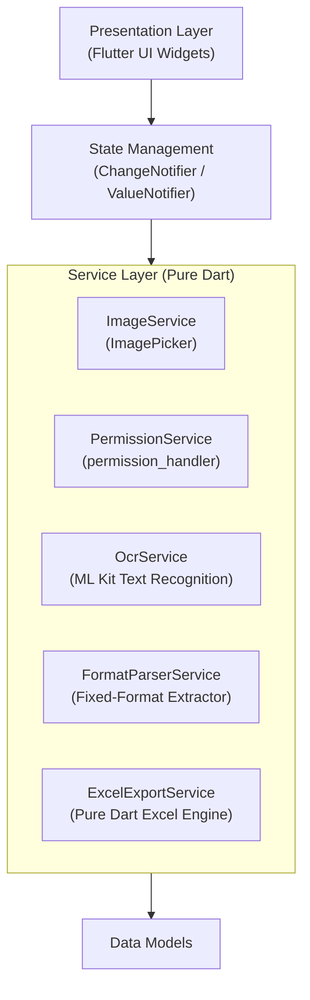
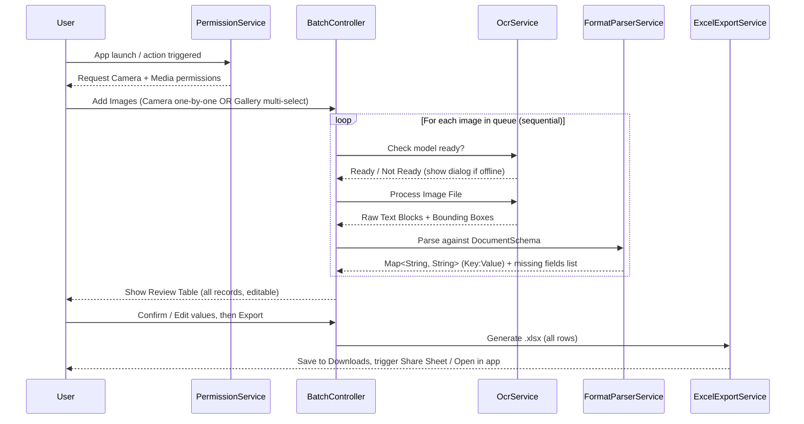

# Implementation Plan: Flutter OCR to Excel (Batch Processing)
> **Revision 2** — Updated to address all identified gaps from plan analysis.

---

## 1. Overview & Constraints

* **Platform:** Android (Flutter 3.47.5 / Dart 3.13.4).
* **Location:** `D:\AndroidDev\Projects\ocr_to_excel` on **`D:` drive only**.
* **Language Policy:** **100% Flutter / Dart**. Zero Java code written by hand. Android native runner uses Kotlin only (`MainActivity.kt` + `build.gradle.kts`).
  > **Note:** `GeneratedPluginRegistrant.java` is auto-generated by Flutter's build system — it is not a violation of the no-Java policy.
* **Android API Range:** `minSdk = 29` (Android 10) — eliminates `WRITE_EXTERNAL_STORAGE` complexity under scoped storage, while still supporting ~95%+ of active Android devices. ML Kit requires minimum API 21; API 29 is a safe superset.
* **Core Flow:** Capture/upload one or multiple images of a fixed format → run on-device OCR → parse into structured `key:value` pairs → review/edit data → export all records into a single formatted `.xlsx` spreadsheet.

---

## 2. App Architecture

The app follows a clean, decoupled 4-layer architecture:



* **Presentation Layer:** Screens for multi-image intake, extraction progress, record review & editing, and export.
* **State Management:** `BatchProcessingController` (a `ChangeNotifier`) managing the image queue, per-image status (`pending`, `processing`, `completed`, `error`), and the aggregated `Map<String, String>` records list.
* **Service Layer (all pure Dart):**
  * `PermissionService` — Centrally requests and checks Camera and media permissions at runtime before any operation.
  * `ImageService` — Wraps `ImagePicker` for both single camera capture (add-to-queue) and multi-image gallery selection.
  * `OcrService` — Integrates Google ML Kit Text Recognition. Handles model readiness and offline fallback.
  * `FormatParserService` — Regex & position-based extractor converting raw OCR text into fixed `key:value` pairs per the configured schema.
  * `ExcelExportService` — Builds styled `.xlsx` files via pure Dart and saves/shares them.

---

## 3. Features & Data Flow

### A. Camera & Multi-Photo Upload

Two supported intake modes:

| Mode | Mechanism | Use Case |
| :--- | :--- | :--- |
| **Camera (one-at-a-time)** | `ImagePicker().pickImage(source: ImageSource.camera)` — called repeatedly; each photo is appended to the queue | Capture documents live, one by one |
| **Gallery Multi-Select** | `ImagePicker().pickMultiImage()` — selects multiple files at once from the device gallery | Upload a pre-photographed batch |

* **Framing Guide:** Camera capture screen overlays a fixed-ratio guide rectangle to help the user align the document consistently.
* **Processing Queue:** Every image is assigned a UUID, a thumbnail preview, a status badge, and will receive its extracted `Map<String, String>` record.

### B. On-Device OCR & Fixed-Format Extraction

* **OCR Engine:** `google_mlkit_text_recognition` — runs natively on-device; no internet call per recognition.
* **ML Kit Model Download Behavior:**
  * The unbundled model is downloaded automatically on first app launch (requires a one-time internet connection, ~3 MB).
  * `OcrService` checks model availability before processing. If the model is not yet ready (first launch, offline), the user is shown a clear dialog: *"OCR model not ready. Please connect to the internet once to download the recognition model."*
  * After the initial download, the app works fully offline.
* **Layout-Aware Extraction in `FormatParserService`:**
  1. OCR text blocks and lines are sorted spatially (top-to-bottom, left-to-right) using bounding box coordinates.
  2. Normalized text is matched against the configured field schema using three complementary strategies:
     * **Pattern 1 — Delimiter-based:** `Key: Value` or `Key - Value` on the same line.
     * **Pattern 2 — Positional/Tabular:** A known header label on one line, value on the immediately following line.
     * **Pattern 3 — Regex Token:** Field-specific regex for dates (`\d{2}/\d{2}/\d{4}`), IDs, amounts (`[\$₹€]?\d+(\.\d{2})?`), phone numbers, etc.
  3. Unmatched fields are left blank and flagged for user review.
* **Schema Definition:** The key schema is declared in a single `DocumentSchema` config class (a Dart `const` map). Adapting to a new document type only requires editing this one file.

### C. Multi-Photo Processing Pipeline



### D. Key:Value → Excel Generation

* **Single Consolidated File:** All processed images produce one row each in a single `.xlsx` file.
* **Column Structure:**

| Column Type | Examples |
| :--- | :--- |
| Metadata (always present) | `Image File Name`, `Processed At (timestamp)` |
| Extracted schema fields | Defined by `DocumentSchema` — e.g. `Invoice No`, `Date`, `Vendor`, `Item`, `Amount` |
| Status | `Extraction Status` (`Completed` / `Partial` / `Failed`) |

* **Formatting:**
  * Header row: bold, coloured background.
  * `Partial` / `Failed` rows: highlighted in amber / red for quick visual identification.
  * Column widths auto-sized to longest content.
* **File Delivery:** Saved to `getExternalStorageDirectory()` (scoped storage, API 29+) via `path_provider`, then surfaced via the Android system share sheet (`share_plus`) and/or directly opened in the device's spreadsheet app (`open_filex`).

---

## 4. Dependencies & Android Permissions

### Required Dart Packages (`pubspec.yaml`)

| Package | Purpose |
| :--- | :--- |
| `google_mlkit_text_recognition` | On-device OCR (no external API) |
| `image_picker` | Camera capture (one-at-a-time) & gallery multi-select |
| `permission_handler` | ✅ **Added** — Runtime permission requests for Camera & media |
| `excel` | Pure Dart `.xlsx` generator (zero Java / Office dependency) |
| `path_provider` | Resolves Android scoped storage directories |
| `share_plus` | Android system share sheet for the generated `.xlsx` |
| `open_filex` | Opens `.xlsx` directly in the user's installed spreadsheet viewer |
| `uuid` | Generates unique IDs for each batch item in the queue |

### Android Permissions & Configuration

**`android/app/build.gradle.kts`:**
```
minSdk = 29   // Android 10 — eliminates WRITE_EXTERNAL_STORAGE requirement
targetSdk = flutter.targetSdkVersion
compileSdk = flutter.compileSdkVersion
```

> [!IMPORTANT]
> `minSdk = 29` avoids all `WRITE_EXTERNAL_STORAGE` complexity. Under Android 10+ scoped storage, apps can write to their own external directory without this dangerous permission.

**`AndroidManifest.xml` additions:**
```xml
<!-- Camera permission for live capture -->
<uses-permission android:name="android.permission.CAMERA" />

<!-- Gallery access (Android 13+) -->
<uses-permission android:name="android.permission.READ_MEDIA_IMAGES" />

<!-- Gallery access (Android 10–12 fallback) -->
<uses-permission android:name="android.permission.READ_EXTERNAL_STORAGE"
    android:maxSdkVersion="32" />

<!-- ML Kit: triggers automatic model download on first launch -->
<meta-data
    android:name="com.google.mlkit.vision.DEPENDENCIES"
    android:value="ocr" />
```

---

## 5. Error Handling & Validation

| Scenario | Handling |
| :--- | :--- |
| Permission denied (Camera / Gallery) | Show rationale dialog via `permission_handler`; graceful fallback disabling that intake mode |
| ML Kit model not downloaded (offline, first launch) | Blocking dialog: *"Connect to internet once to download the OCR model (~3 MB)"* |
| Blurry / unreadable image | Image status set to `Failed`; user can retake (camera) or remove and re-upload |
| Fixed-format field missing in OCR output | Field left blank; highlighted in review table; user can fill manually |
| Storage write failure | Snackbar error with retry; fall back to in-app share sheet |
| Empty queue export attempt | Export button disabled + tooltip: *"Add at least one processed image"* |
| All user-editable cells | Tap-to-edit inline in the review table before exporting |

---

## 6. Testing Plan

### Unit Tests (`test/`)

| Test | Target |
| :--- | :--- |
| `format_parser_test.dart` | Core parsing logic: delimiter, positional, regex patterns against mock OCR strings |
| `excel_service_test.dart` | Correct `.xlsx` structure, headers, row count, and cell values |
| `batch_controller_test.dart` | Queue state transitions (`pending → processing → completed / error`) |

### Widget Tests (`test/`)

| Test | Target |
| :--- | :--- |
| `home_screen_test.dart` | Queue list renders correct status badges; Add button triggers picker |
| `review_screen_test.dart` | Editable cells update state; Export button disabled on empty queue |

### Integration / Manual Tests (on `Pixel_9_Pro` emulator)

| Scenario | Expected Result |
| :--- | :--- |
| First launch (no model) with Wi-Fi on | ML Kit model downloads; OCR runs successfully |
| First launch with Wi-Fi off | Clear offline dialog shown; no crash |
| Add 1 image via camera | Photo added to queue, status changes to `Completed` with parsed data |
| Add 3 images via gallery multi-select | All 3 processed sequentially; review table shows 3 rows |
| One blurry image in batch of 3 | 1 row marked `Failed`, 2 rows `Completed`; export proceeds with available data |
| Tap cell in review table and edit | Value updates in state; exported Excel reflects edited value |
| Export to Excel | `.xlsx` file saved to Downloads; opens correctly in Google Sheets / WPS |
| Deny Camera permission | Camera mode gracefully disabled; gallery mode still works |

---

## 7. Project Directory Structure

```text
D:\AndroidDev\Projects\ocr_to_excel\
├── android/                          # Kotlin-only native host
│   └── app/
│       ├── build.gradle.kts          # minSdk = 29, Kotlin DSL
│       └── src/main/
│           ├── AndroidManifest.xml   # Camera, media, ML Kit meta-data
│           └── kotlin/.../MainActivity.kt
├── lib/
│   ├── main.dart                     # App entry point & MaterialApp theme
│   ├── config/
│   │   └── document_schema.dart      # ✅ Fixed-format key schema (single edit point)
│   ├── models/
│   │   ├── batch_item.dart           # Per-image: ID, status, thumbnail path, record
│   │   └── extraction_result.dart    # Holds Map<String,String> + missing fields list
│   ├── services/
│   │   ├── permission_service.dart   # ✅ Runtime permission requests & checks
│   │   ├── image_service.dart        # Camera (one-at-a-time) + gallery multi-select
│   │   ├── ocr_service.dart          # ML Kit wrapper + model readiness check
│   │   ├── format_parser.dart        # Fixed-format extraction (3 patterns)
│   │   └── excel_service.dart        # Pure Dart .xlsx builder & file saver
│   ├── state/
│   │   └── batch_controller.dart     # ChangeNotifier: queue + sequential processing
│   └── views/
│       ├── home_screen.dart          # Intake UI: queue list, Add button, Export button
│       ├── review_screen.dart        # Review/edit table, Export confirmation
│       └── widgets/
│           ├── image_queue_card.dart # Thumbnail + status badge per item
│           ├── editable_data_table.dart  # Tap-to-edit key:value table
│           └── permission_dialog.dart    # Reusable permission rationale dialog
├── test/
│   ├── format_parser_test.dart
│   ├── excel_service_test.dart
│   ├── batch_controller_test.dart
│   ├── home_screen_test.dart
│   └── review_screen_test.dart
└── pubspec.yaml
```

---

## 8. Implementation Phases

| Phase | Tasks | Output |
| :--- | :--- | :--- |
| **Phase 1** — Config & Dependencies | Update `pubspec.yaml` (all 8 packages); set `minSdk = 29` in `build.gradle.kts`; add permissions + ML Kit meta-tag to `AndroidManifest.xml` | App builds cleanly; `flutter pub get` succeeds |
| **Phase 2** — Config & Models | Create `document_schema.dart` (key field definitions); implement `BatchItem` and `ExtractionResult` models | Data structures ready |
| **Phase 3** — Core Services | Implement `PermissionService`, `ImageService`, `OcrService` (with offline guard), `FormatParserService`, `ExcelService` | Each service independently functional |
| **Phase 4** — State Management | Implement `BatchController`: add items, drive sequential OCR+parse pipeline, notify UI | State drives all data mutations |
| **Phase 5** — User Interface | Build `HomeScreen` (queue + intake buttons), `ReviewScreen` (editable table + export), all supporting widgets | Full UI flow |
| **Phase 6** — Export & Share | Wire `ExcelService` → save to scoped storage → `share_plus` + `open_filex` | `.xlsx` opens in Google Sheets / WPS on device |
| **Phase 7** — Testing | Write & run all unit + widget tests; manual integration tests on `Pixel_9_Pro` emulator | All tests pass; end-to-end verified |

---

## 9. Open Decision (Required Before Implementation)

> [!IMPORTANT]
> **The fixed-format document schema is the critical missing piece.**
> The `FormatParserService` extraction rules and `document_schema.dart` key definitions cannot be finalised until the actual document type and its fields are known.
>
> **Please provide one of the following before confirming implementation:**
> * A description of the document type (e.g., "a printed invoice", "a lab report", "a handwritten form")
> * The list of fields/keys to be extracted (e.g., `Invoice No`, `Date`, `Customer Name`, `Total`)
> * A sample image or sketch of the document layout
>
> All other parts of the plan are ready to implement immediately.
